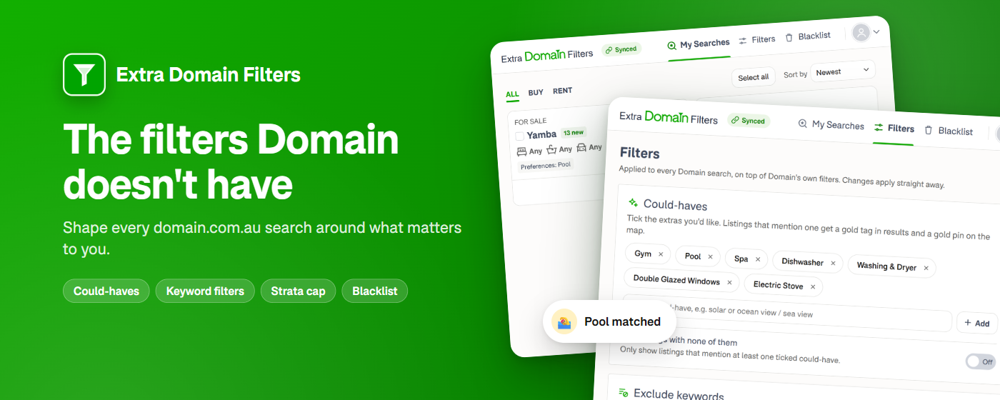
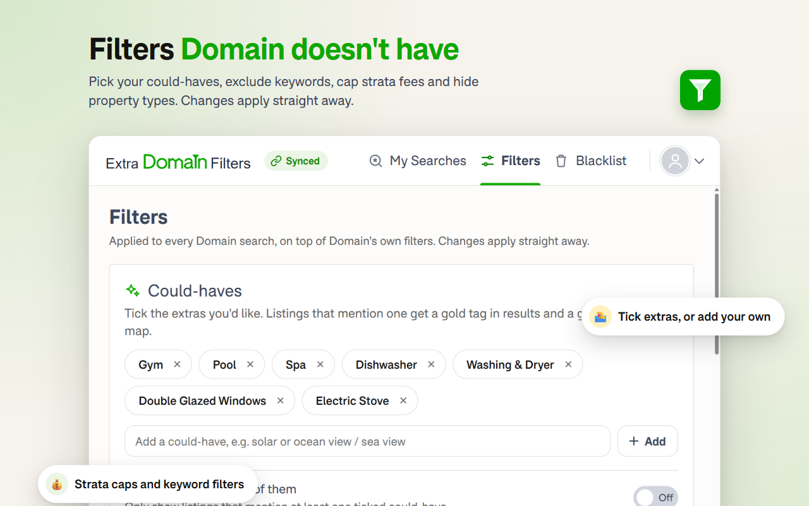
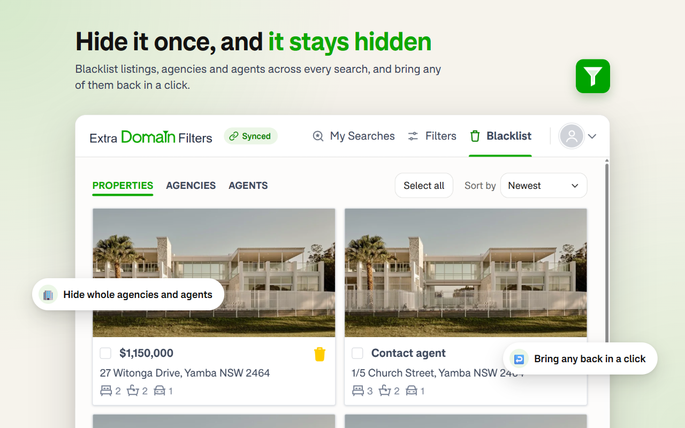
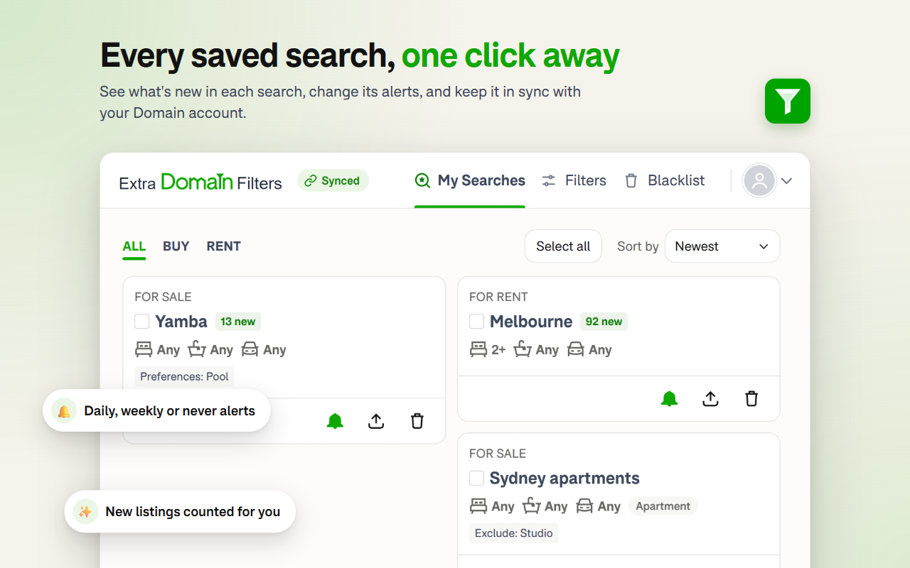

# Extra Domain Filters

**The filters Domain.com.au doesn't have, right inside Domain.**

Tick the extras you'd love 🏊, **hide the listings you never want to see again** 🚫, and keep every saved search one click away 🔖. It works on domain.com.au in **Chrome, Edge, Firefox, Opera and Safari**.

- 🧩 **[Add to Chrome](https://chromewebstore.google.com/detail/extra-domain-filters/opblibcobnkicpdjkinngfcbjjnjldkg)**
- 🌐 **[Website](https://extra-domain-filters.web.app/)**
- 💬 **[Support](https://extra-domain-filters.web.app/support/)**

## ✨ Features

### 🎯 Could-haves

- **Tick the extras you'd like**, such as a pool, a dishwasher or double glazing.
- **Add your own** 🖊️. "Ocean view / sea view" matches either phrase.
- Listings that mention one get a **gold tag** in results and a **gold pin** on the map 📍.
- Hide listings that mention none of them, or **reset** the list to the defaults.

### 🧹 Filters Domain doesn't have

- **Exclude keywords**: hide listings whose description mentions words like "studio" or "tenanted".
- **Strata fees**: hide listings whose quarterly strata is above your maximum 💰.
- **Property types**: types you untick stay hidden, **including listings described as one**, like a "3 bedroom townhouse" tagged as a house.
- Every filter lives **in Domain's own filter panel**, and on the Filters page in the toolbar popup.

### 🚫 Blacklist

- **Hide a listing** with the bin on its card, and it stays out of every search.
- **Hide an agency or an agent**, and every listing from them goes too 🏢.
- Hidden listings fold into **one tidy summary** at the end of the results, each with why it's hidden and a button to bring it back.
- Pins of hidden listings **disappear from the map** 🗺️.

### 🔖 Saved searches and your shortlist

- **Every saved search in one place**, with what's new, its filters and its alerts 🔔.
- Choose **Daily, Weekly or Never** for Domain's email alerts.
- **Share a search**, filters included, with a link 🔗.
- **Notes on shortlisted listings** 📝: "Add note" turns the card over to your note, and "View details" turns it back.

### 🔄 Sync

**Sign in to keep your filters, blacklist and saved searches the same on every browser you use.** On Chrome, sign in with Google, Apple, Facebook or email; on other browsers, with email. An account is **optional**: everything works without one.

## 🌐 Browsers

| Browser             | Filters and blacklist | Google, Apple or Facebook sign-in | Email sign-in | Where to get it                   |
| ------------------- | :-------------------: | :-------------------------------: | :-----------: | --------------------------------- |
| **Chrome**          |          ✅           |                ✅                 |      ✅       | Chrome Web Store                  |
| **Edge**            |          ✅           |            Coming soon            |      ✅       | Microsoft Edge Add-ons            |
| **Firefox**         |          ✅           |                ❌                 |      ✅       | Firefox Add-ons                   |
| **Opera, Opera GX** |          ✅           |            Coming soon            |      ✅       | Opera add-ons or Chrome Web Store |
| **Safari for Mac**  |          ✅           |                ❌                 |      ✅       | App Store                         |
| **Brave, Vivaldi**  |          ✅           |                ✅                 |      ✅       | Chrome Web Store                  |

## 🚀 Get started

1. **Install** Extra Domain Filters from your browser's extension store 🧩.
2. **Pin it** to your toolbar 📌.
3. **Open a search** on [domain.com.au](https://www.domain.com.au): your filters appear in Domain's filter panel.

## ❓ Questions

**Do I need an account?**

No. Everything works without one. An account only syncs your setup between browsers.

**Why is a listing hidden?**

Open the **hidden listings summary** at the end of the results. Each listing shows the filter or blacklist entry that hides it, and a button to show it again.

**Where are the settings?**

In the **toolbar popup** under your avatar, and on Domain under your profile as **Extension preferences**.

More answers are on the [support page](https://extra-domain-filters.web.app/support/).

## 🔒 Privacy

**Your filters and blacklist stay in your browser unless you sign in to sync them.** Listing descriptions are read from Domain in the background, one at a time, only to apply your filters. The extension talks to domain.com.au and, when you sign in, its own sync service, and **nothing else**. Read the [privacy policy](https://extra-domain-filters.web.app/privacy/).

## 💚 Credits

Extra Domain Filters is made by [Niclas Rogulski](https://github.com/IronExcavater) and released under the [MIT License](LICENSE). Want to help? See [**Contributing**](CONTRIBUTING.md).

_Extra Domain Filters is not affiliated with, endorsed by or sponsored by Domain Holdings Australia._
